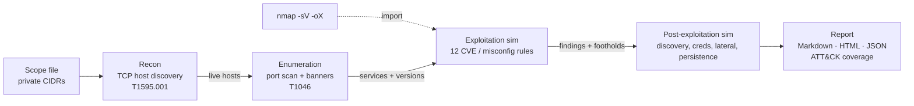

# Auto Strike: Automated Red Team Framework

[](https://github.com/Pzycokid/autostrike/actions/workflows/ci.yml)


Auto Strike runs a **multi-phase attack chain against authorised lab targets** and turns the
result into a report a defender can act on:

```
reconnaissance → enumeration → exploitation simulation → post-exploitation planning → reporting
```

Each phase hands its output to the next (live hosts → open services → findings → follow-on
steps), the way a real kill chain progresses. Everything an attacker could do is **mapped to
MITRE ATT&CK**, with CVE references and a concrete fix for every finding.

> **Safety model.** Exploitation and post-exploitation are *simulated*: Auto Strike matches
> fingerprinted services against a rule base and plans what an operator would do next, but it
> never sends an exploit or runs commands on a target. Live scans are limited to an explicit
> scope (private ranges only unless you say otherwise) and refuse to start without `--authorized`.

## Kill chain



| Phase | What it does | ATT&CK |
|---|---|---|
| Recon | TCP connect probes on common ports to find live hosts in scope (no raw packets, no admin rights) | T1595.001 |
| Enumeration | Port scan, banner grab (HTTP `HEAD`, Redis `PING`), product/version fingerprinting, OS guess | T1046 |
| Exploitation simulation | Matches services to known weaknesses: vsftpd 2.3.4 backdoor, Apache 2.4.49 traversal, MS17-010, Samba usermap_script, ProFTPD mod_copy, unauthenticated Redis, exposed Tomcat Manager, Telnet, RDP… | T1190, T1210, T1078.001, T1087, T1040, T1021.001 |
| Post-exploitation simulation | For every critical/high foothold, plans discovery, credential access, persistence and lateral movement toward other in-scope hosts (never executed) | T1082, T1083, T1552.001, T1003, T1053, T1021.x, T1005 |
| Reporting | Severity summary, host inventory, findings with evidence and remediation, the simulated plan and an ATT&CK coverage table | – |

## Quick start

```bash
git clone https://github.com/Pzycokid/autostrike.git
cd autostrike
pip install -e ".[dev]"

# 1. Offline demo: full kill chain against a simulated 5-host lab
autostrike demo --out demo

# 2. Analyse an existing nmap service scan (skips recon/enumeration)
nmap -sV -oX lab.xml 192.168.56.0/24
autostrike import-nmap lab.xml --out lab-report

# 3. Live run against your own lab network
echo "192.168.56.0/24" > scope.txt
autostrike run --scope scope.txt --authorized --ports top --out lab-run

# Re-render reports from a saved engagement
autostrike report lab-run/engagement.json
```

Open `report.html` for the full report. A sample generated from the demo lab is in
[`docs/sample-report/`](docs/sample-report/report.md).

## Sample output (demo lab)

```
[recon] 5 live host(s) out of 254 address(es) probed
[enumeration] 15 open service(s) fingerprinted on 5 host(s)
[exploitation-sim] 9 finding(s), 3 critical
[post-exploitation-sim] 30 simulated step(s) across 3 foothold(s)
[reporting] wrote report.json, report.md, report.html
```

| Severity | Finding | Host | CVE | ATT&CK |
|---|---|---|---|---|
| Critical | Apache HTTP Server 2.4.49 path traversal | 10.10.10.5:80 | CVE-2021-41773 | T1190 |
| Critical | vsftpd 2.3.4 backdoored release | 10.10.10.12:21 | CVE-2011-2523 | T1190 |
| Critical | SMBv1 enabled (MS17-010 exposure) | 10.10.10.12:445 | CVE-2017-0144 | T1210 |
| High | Tomcat Manager application exposed | 10.10.10.5:8080 | – | T1078.001 |
| High | Redis accepts unauthenticated commands | 10.10.10.20:6379 | – | T1190 |
| High | Telnet remote access in cleartext | 10.10.10.30:23 | – | T1040 |

The patched hosts in the lab (OpenSSH 8.9, the SMB-signing domain controller) correctly produce
no findings.

## Safety controls

- **Scope enforcement:** every probe passes through `Scope.require()`. Out-of-scope addresses
  raise `ScopeError` before a socket is opened.
- **Private by default:** public ranges are rejected unless `--allow-public` is passed, and
  scopes larger than 4,096 addresses are refused.
- **Explicit consent:** `autostrike run` exits unless `--authorized` is given.
- **No exploit code:** the exploitation and post-exploitation phases only produce findings and
  plans. They contain no payloads, no shellcode and no command execution.
- **Polite scanning:** plain TCP connect probes with per-connection timeouts and a bounded
  worker pool.

## Project structure

```
autostrike/
├── cli.py            # demo / run / import-nmap / report
├── pipeline.py       # runs phases in order, saves engagement.json after each hand-off
├── phases.py         # Recon, Enumeration, ExploitSim, PostExploitSim, Report
├── scope.py          # authorised-scope parsing and enforcement
├── transport.py      # LiveTransport (sockets) and SimTransport (offline lab)
├── fingerprint.py    # banner → service/product/version, OS guess
├── nmap_import.py    # nmap -sV -oX parser
├── report.py         # Markdown, HTML and JSON reports + ATT&CK coverage
└── data/
    ├── vuln_rules.json   # CVE / misconfiguration rules
    ├── attack.json       # ATT&CK technique names and tactics
    └── demo_lab.json     # simulated 5-host lab network
tests/                    # 18 pytest tests incl. a real-socket localhost run
```

## Extending the rule base

Rules live in `autostrike/data/vuln_rules.json`. A rule matches on `product`, `name`,
`banner_contains` and version bounds (`version_eq`, `version_lt`, `version_lte`, `version_gte`):

```json
{
  "id": "AS-002",
  "match": {"product": "OpenSSH", "version_lt": "7.7"},
  "title": "OpenSSH username enumeration",
  "severity": "medium",
  "cve": "CVE-2018-15473",
  "technique": "T1087",
  "description": "...",
  "remediation": "Upgrade OpenSSH to 7.7 or later..."
}
```

`tests/test_fingerprint_rules.py` checks that every rule is well formed and maps to a known
ATT&CK technique.

## Tests

```bash
pytest -q
```

CI runs the suite on Python 3.10–3.12 and uploads the demo report as a build artifact.

## Related projects

- [RedSim](https://github.com/Pzycokid/redsim): ATT&CK adversary simulation that generates telemetry
- [BlueShield](https://github.com/Pzycokid/blueshield): the defensive side, with detection-as-code and SOAR triage
- [Wazuh SOC Lab](https://github.com/Pzycokid/wazuh-soc-lab) · [Suricata IDS Lab](https://github.com/Pzycokid/suricata-ids-lab)

## Legal

For education and **authorised** security testing only. Run it only against systems you own or
have written permission to test.

---

**Likhith H S**, M.Sc. Cyber Security (NFSU Goa) · CEH v12 & CCNA trained ·
[LinkedIn](https://linkedin.com/in/likhith15) · [GitHub](https://github.com/Pzycokid)
